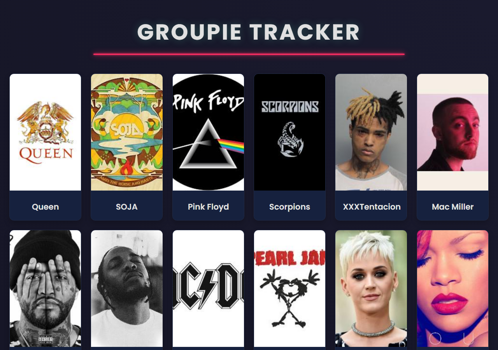

# Groupie Tracker — Visualizations

The follow-up stage of [Groupie Tracker](../README.md). It focuses on presenting the artist, location, date and relation data in a clear, visual and user-friendly way.



## Highlights

- Card-based artist gallery with images and hover effects
- A detail page that groups each concert location with its dates
- Consistent dark design across every page, including the error pages

## Run

```bash
go run .
```

Then open <http://localhost:8080>.

See the [main README](../README.md) for the API details and more screenshots.
